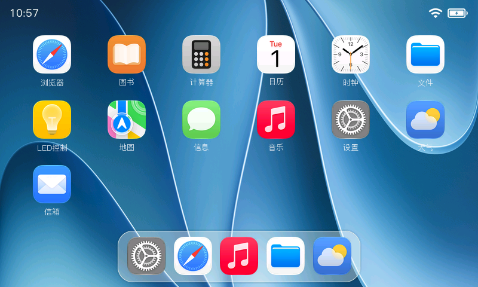
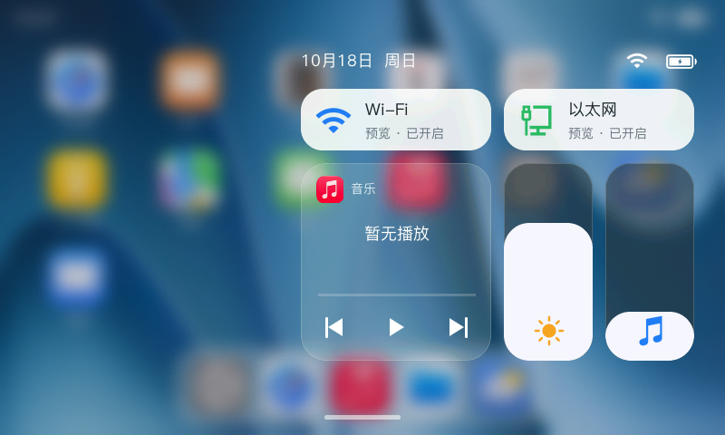
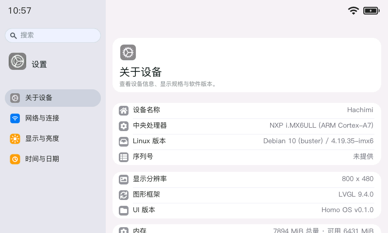
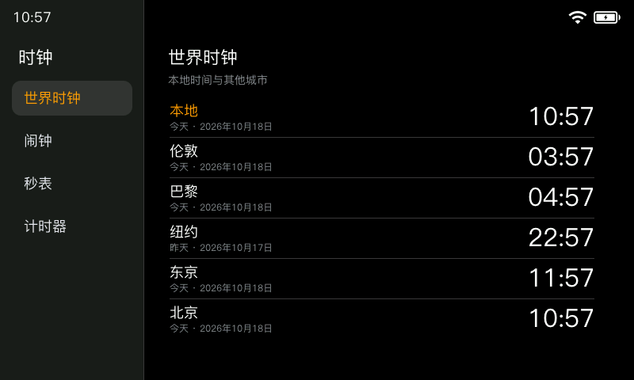
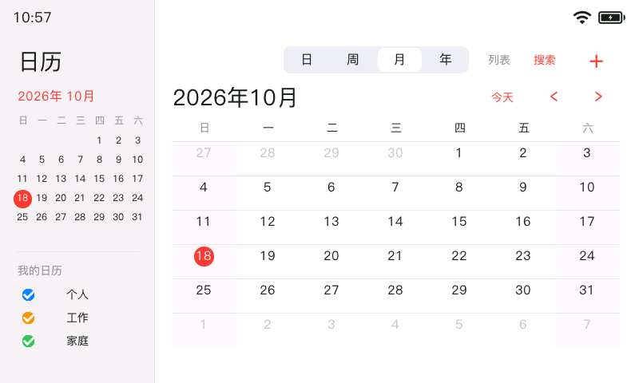
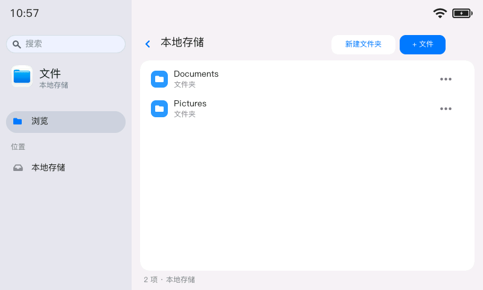
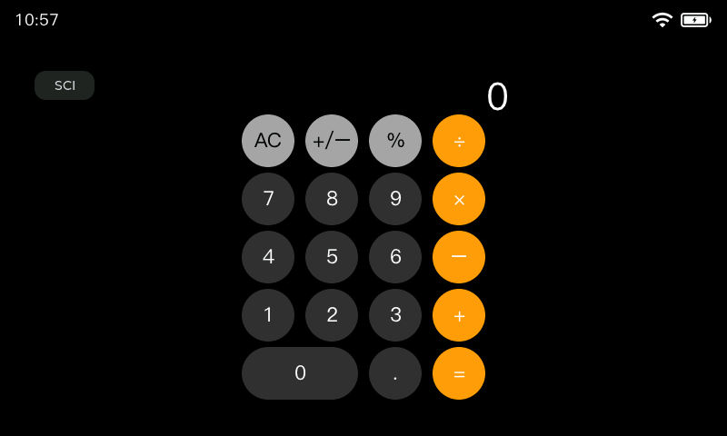
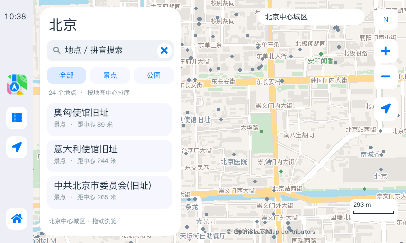

# Homo OS Linux

**一个基于 LVGL 的嵌入式 Linux 触屏桌面。**

Homo OS 将桌面、应用和常用设备控制整合在一个轻量的图形界面中。以 i.MX6ULL 开发板为主要运行平台，围绕 800 × 480 触摸屏设计，提供应用启动、手势操作、控制中心，以及一组日常使用的小应用。



[快速开始](#快速开始) · [应用展示](#应用展示) · [架构与扩展](ARCHITECTURE.md) · [下载发布版本](https://github.com/mosking128/Homo-OS-Linux/releases)

## 桌面体验

熟悉的应用网格与 Dock，配合应用展开、收起动画和边缘返回手势，让小尺寸触摸屏也能自然地切换应用。下拉控制中心即可查看连接状态、调节亮度与音量，并控制音乐播放。

桌面之外，时钟提醒和音乐播放可以在后台继续工作。应用界面、后台服务和平台适配分别组织，便于根据设备用途增加应用或裁剪功能。

这是可独立构建的 Linux 桌面项目，通过 framebuffer 显示、evdev 接收触摸输入；它运行在已有 Linux 系统之上。

## 应用展示

以下为 800 × 480 界面截图。桌面及多数应用截图由 Linux 预览后端采集，控制中心的设备状态显示为预览数据。

<table>
  <tr>
    <td align="center"><strong>控制中心</strong><br></td>
    <td align="center"><strong>设置</strong><br></td>
  </tr>
  <tr>
    <td align="center"><strong>时钟</strong><br></td>
    <td align="center"><strong>日历</strong><br></td>
  </tr>
  <tr>
    <td align="center"><strong>文件</strong><br></td>
    <td align="center"><strong>计算器</strong><br></td>
  </tr>
  <tr>
    <td align="center" colspan="2"><strong>地图</strong><br></td>
  </tr>
</table>

## 内置功能

| 应用 | 功能 |
| --- | --- |
| 设置 | 设备信息、网络连接、显示与亮度、日期与时间 |
| 文件与图书 | 本地文件浏览、新建、重命名和删除，TXT 书籍阅读 |
| 计算器 | 基础计算与科学计算模式 |
| 时钟 | 世界时钟、闹钟、秒表、倒计时与跨应用提醒 |
| 日历 | 日、周、月、年视图，本地日程编辑与搜索 |
| 天气 | 当前天气、三日预报、生活建议与本地缓存；需配置天气服务密钥 |
| 地图 | 北京离线地图、地点搜索、分类筛选、拖动与缩放 |
| 音乐 | 本地 WAV 播放、LRC 歌词与后台播放 |
| LED 控制 | RGB 灯控制，需适配板端硬件 |

浏览器、信息与信箱目前用于界面展示，尚未接入网页引擎或真实消息、邮件服务。地图目前提供离线浏览与搜索，不提供 GPS 定位或路线导航。

## 运行平台

| 项目 | 说明 |
| --- | --- |
| 主要硬件 | NXP i.MX6ULL / ARM Cortex-A7 |
| 显示 | 800 × 480，RGB565，Linux framebuffer |
| 输入 | evdev 触摸设备 |
| 图形框架 | LVGL 9.4 |
| 可选加速 | ARM NEON、i.MX PXP；支持软件渲染路径 |

移植到其他 Linux 设备时，需要适配显示、输入及设备控制接口。平台入口与业务代码分离，相关实现位于 `platform/linux/`。

## 快速开始

### 在 Linux 上构建

准备 C 编译器与 CMake 3.16+，在仓库根目录执行：

```sh
cmake -S platform/linux -B build/native -DCMAKE_BUILD_TYPE=Release -DBUILD_TESTING=OFF
cmake --build build/native --parallel 4
```

程序与运行资源输出到 `build/native/bin/`。运行桌面需要 framebuffer 和 evdev 设备。

### 为 i.MX6ULL 交叉编译

使用与目标系统 glibc 兼容的 ARM hard-float 工具链：

```sh
CROSS_COMPILE=arm-linux-gnueabihf- JOBS=4 sh platform/linux/build-armhf.sh
```

输出目录为 `platform/linux/build-armhf/bin/`。将其中的 `hachimi_desktop` 与 `assets/` 一起复制到板端运行目录，然后启动：

```sh
./hachimi_desktop
```

默认显示设备为 `/dev/fb0`，触摸设备为 `/dev/input/event2`，可通过 `HACHIMI_FBDEV`、`HACHIMI_EVDEV` 指定。完整构建、部署步骤见 [Linux 使用指南](docs/linux-standalone.md)，设备权限与 systemd 配置见 [Linux 平台说明](platform/linux/README.md)。

## 开发与文档

应用通过统一模块接口接入桌面，产品清单决定桌面入口及后台模块。新增应用无需修改桌面动画或 Linux 启动入口；按需裁剪时，可同时调整产品清单与源码清单。详见 [架构与应用扩展](ARCHITECTURE.md)。

- [Linux 构建与部署](docs/linux-standalone.md)
- [控制中心](docs/control-center.md)
- [时钟](docs/clock.md) · [日历](docs/calendar.md)
- [天气配置](docs/weather.md) · [离线地图](docs/maps.md) · [音乐与歌词](docs/music.md)

## 许可与致谢

项目自有代码采用 [MIT 许可证](LICENSE)。感谢 [LVGL](https://github.com/lvgl/lvgl)、[PingFangSC](https://github.com/refinec/PingFangSC) 与 [OpenStreetMap](https://www.openstreetmap.org/copyright) 等项目提供的基础支持。

第三方代码、字体、地图数据及图形资源分别遵循其原有许可，具体来源与许可说明见 [第三方资源清单](licenses/THIRD_PARTY.md)。
