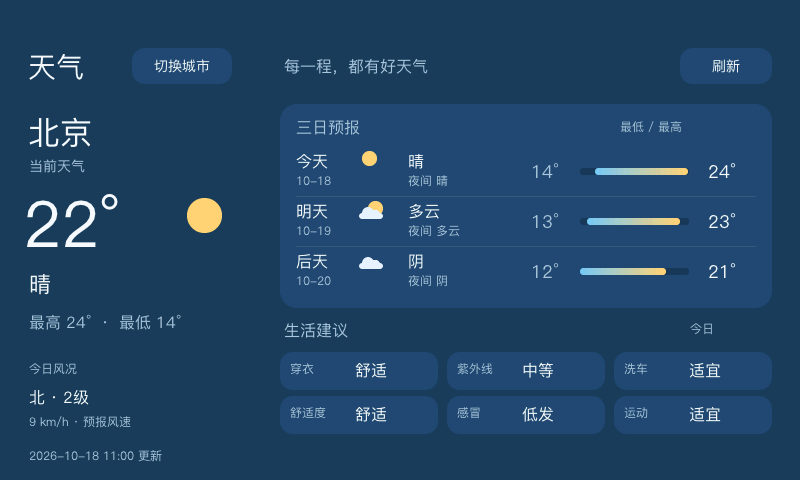

# 天气

天气从桌面和 Dock 的天气图标进入，默认北京，适配 800×480 的 LVGL 桌面。

截图使用北京的示例数据展示布局，不代表实时天气；实际运行时显示天气接口或本地缓存返回的数据。

## 数据和界面

- 当前天气：城市、天气现象、气温、接口更新时间。
- 三日预报：日期、日间和夜间天气、高低温、对齐的温度范围条；左侧展示今日预报风向、风级及风速，不冒充实况风速。
- 生活建议：穿衣、紫外线、洗车、感冒、运动，以及实测响应返回的舒适度；舒适度缺失时尝试旅游指数。只生成接口实际返回的卡片，点击查看详情，只有 brief 时也可使用。
- 城市选择：北京、上海、杭州、成都、武汉、西安快捷入口，以及城市拼音输入。地点是否可查询取决于账号权限。

参考界面只用于布局方向。没有请求逐小时天气、空气质量、雷达或预警，也不填充虚构数据。

使用心知天气 v3 HTTPS：`weather/now.json`、`weather/daily.json`（`start=0&days=3`）、`life/suggestion.json`。生活指数同时兼容对象和数组两种响应形式。免费数据范围和错误码分别见[官方数据说明](https://docs.seniverse.com/product/data/free.html)和[错误码说明](https://docs.seniverse.com/api/start/error.html)。实际返回字段优先。

## 密钥和缓存

密钥不编译到源码，也不显示在界面或日志中。读取优先级：

1. 环境变量 `HACHIMI_WEATHER_KEY`。
2. 天气状态目录内的 `weather.key`，内容为一行私钥。

状态目录默认 `$HOME/.hachimi-weather`；可用 `HACHIMI_WEATHER_DIR` 覆盖。板端 systemd 的 HOME 为 `/home/debian`，所以密钥路径是 `/home/debian/.hachimi-weather/weather.key`。Linux 目录权限建议 700，密钥权限 600。配置文件独立于应用替换，无需重新构建。

同目录下 `location` 保存所选城市，三个 `cache-N.json` 保存各接口最后成功的 JSON、获取时间和查询地点。读取缓存仍经过完整解析；城市不匹配的缓存不会使用。切换城市立即清除页面中的旧城市数据。网络失败保留同城成功数据并显示错误提示及实际更新时间；超过一小时显示“上次天气”。

打开应用时缓存超过 30 分钟则刷新，应用在前台时每 30 分钟刷新。手动刷新最少间隔 60 秒，三个请求串行且间隔至少 1.1 秒；切换城市重新请求。单个接口失败不会丢弃其他接口的数据。Linux 在工作线程中以独立 curl 子进程请求，密钥 URL 经 stdin 传入而非命令参数。主线程只轮询完成状态，不执行联网操作。

## 运行依赖

Linux 通过独立 curl 子进程请求 HTTPS 数据，系统需要安装 curl 和有效的 HTTPS 根证书。天气密钥与状态目录的配置方式见上文。
